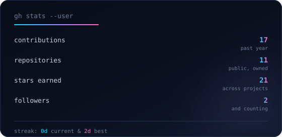
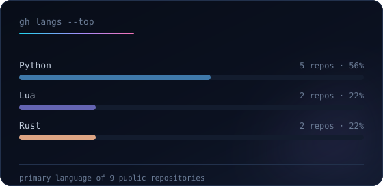
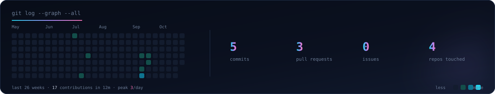

<div align="center">
  
</div>

<br/>

## `$ whoami`

```python
class Yarfer:
    role    = "backend & systems engineer"
    focus   = ["high-load APIs", "telegram automation", "rust systems", "reverse engineering"]
    stack   = {"langs": ["Python", "Rust", "Lua", "TypeScript"],
               "back":  ["FastAPI", "SQLAlchemy 2.0", "PostgreSQL", "Redis"],
               "infra": ["Docker", "Linux", "Nginx", "GitHub Actions"]}
    motto   = "ship it, then make it fast"
```

I build services that survive production: async APIs on **FastAPI + PostgreSQL**, bots on
**aiogram** that handle real traffic, and **Rust** tooling when Python is too slow to be fun.
Most of my work lives in private repos — everything below is what I can show.

<br/>

## `$ stack --list`

<div align="center">


<sub>reverse engineering: Frida · Ghidra · mitmproxy · rizin</sub>

</div>

<br/>

## `$ ls ~/oss`

| Project | What it is |
| :--- | :--- |
| **[rs.parser&#8209;nft](https://github.com/Yarfer800/rs.parser-nft)** ⭐ | Telegram NFT-gift parser: instant snapshots of marketplace drops, dedup and alerts — `Rust` `Python` |
| **[sync&#8209;player](https://github.com/Yarfer800/sync-player)** | Watch-party Telegram Mini App: rooms, a shared player locked to one timecode, realtime chat — `FastAPI` `Redis` `React 19` |
| **[ferris-os](https://github.com/Yarfer800/ferris-os)** | A minimal Linux distribution written in Rust — safe by default, no bloat — `Rust` `Linux` |
| **[local&#8209;vless&#8209;mgr](https://github.com/Yarfer800/local-vless-mgr)** | VLESS sources → TCP+TLS probe → GeoIP → Marzban users + sing-box subscription with auto-balancer — `Python` `Docker` |
| **[l7&#8209;nightcrawler](https://github.com/Yarfer800/l7-nightcrawler)** | Traffic engine with 11 vectors, proxy rotation, live dashboards and measured benchmarks — `Rust` `Tokio` |
| **[Nvim-Config](https://github.com/Yarfer800/Nvim-Config)** | My daily-driver Neovim setup: LSP, treesitter, zero-lag UX, fully Lua — `Lua` |

<br/>

## `$ gh stats`

<div align="center">






</div>

<sub>cards are generated by [`scripts/gen_stats.py`](./scripts/gen_stats.py) and refreshed daily by GitHub Actions — no third-party services, so they never break</sub>

<br/>

## `$ cat about.ru.txt`

<details>
<summary><b>🇷🇺 Обо мне по-русски</b></summary>

<br/>

Бэкенд- и системный инженер. Пишу сервисы на **Python** (FastAPI, SQLAlchemy 2.0, aiogram)
и инструменты на **Rust**, когда нужна скорость и контроль над памятью.

- **Backend:** асинхронные API, PostgreSQL + Redis, Alembic, JWT, rate-limit, Docker-деплой.
- **Telegram:** боты и Mini Apps на aiogram 3 — от автопостинга до realtime-плеера.
- **Systems / RE:** Rust-утилиты, разбор приложений (Frida, Ghidra, mitmproxy), анализ сетевого трафика.
- **Как пишу:** без магии в коде, тесты на критичных путях, документация рядом с кодом.

Открыт к интересным задачам и коллаборациям — пишите в issues.

</details>

<br/>

<div align="center">

<b>let's build something that actually ships</b>

<a href="https://github.com/Yarfer800"></a>

<br/><br/>


</div>
